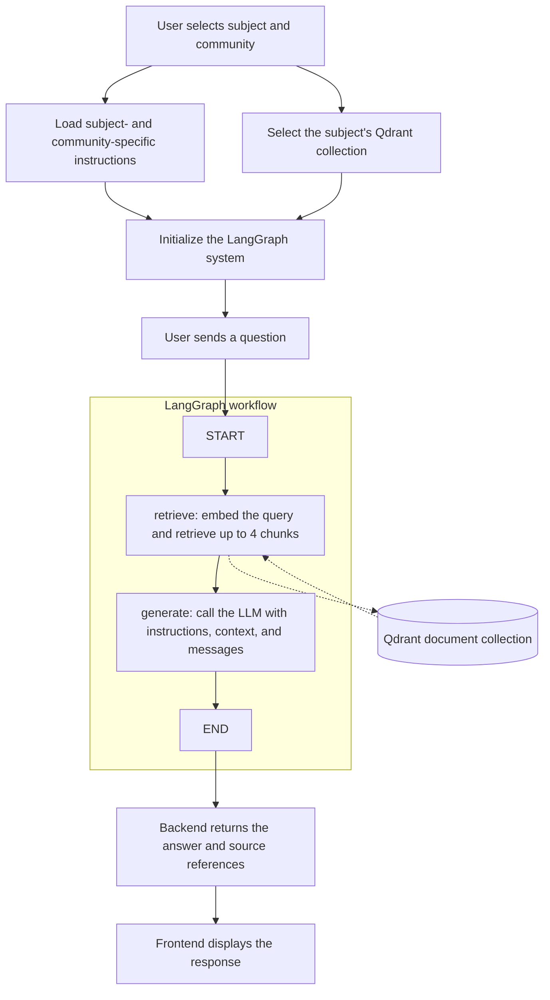
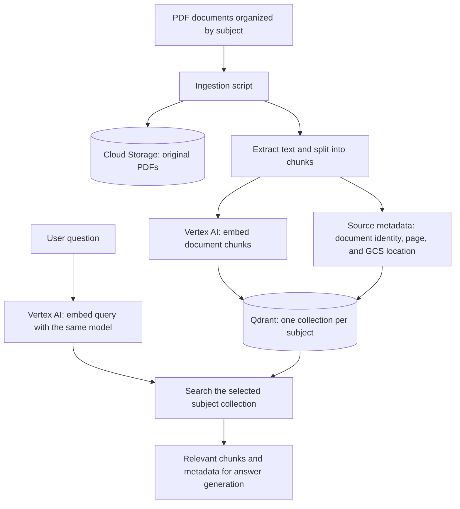
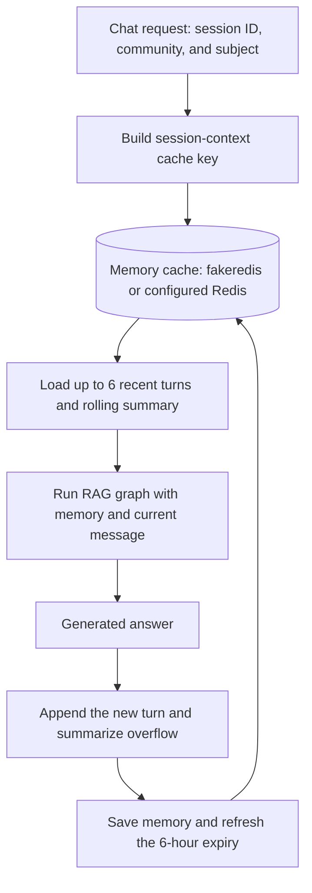
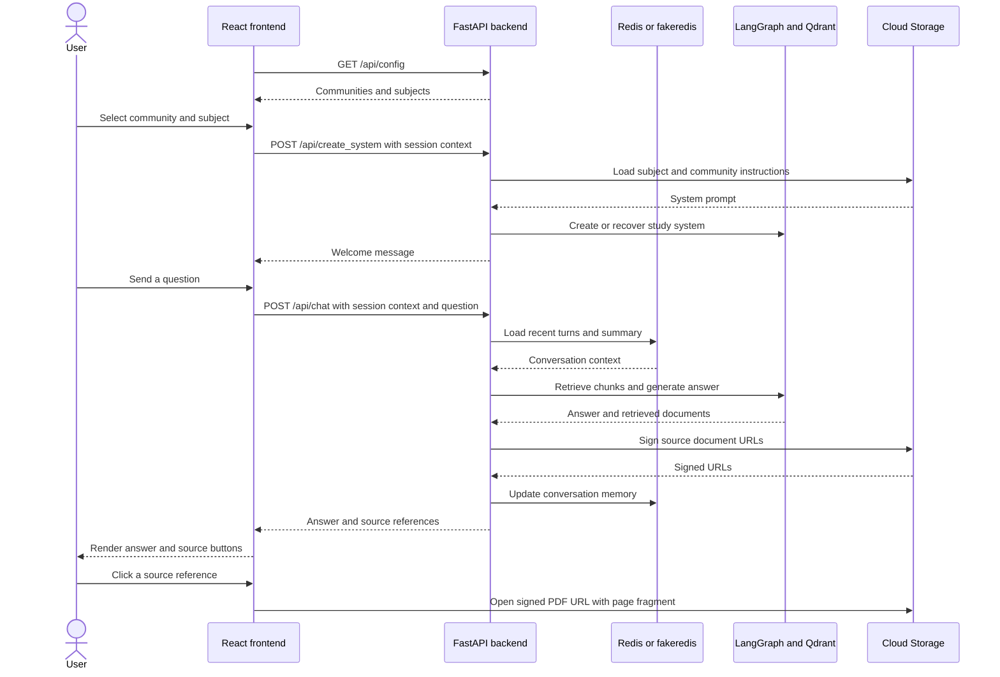
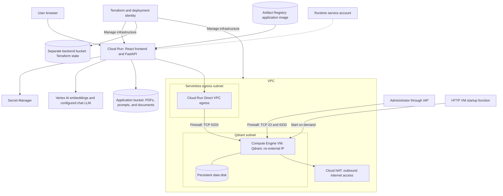
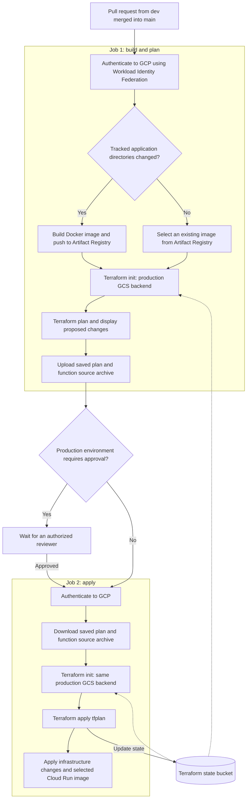

# Basic RAG App (App code used for PAUHelper)

*A basic modern app that enriches LLM context using specific vector spaces and instructions based on user-selected buttons.*

## Description

This code demonstrates how a basic modern retrieval-augmented generation (RAG) application works. Given an organized, well-structured document database, the app extracts information, stores metadata such as page numbers and document IDs alongside chunks, and enriches the LLM's context to generate accurate responses with document references.

This code was used to power PAUHelper, a production app designed to help Spanish students pass the EBAU university entrance exams. The original app has an Android frontend. A basic React frontend was developed for this repository to provide a web interface.

Feel free to use this code in your own projects.

## 1. Business overview, use case and value

### The problem

Organizations and individuals often have large amounts of information spread across PDF documents. For students in Spain preparing for university entrance exams, this includes subject notes, study materials, and exam requirements. Searching these documents one by one is time-consuming.

Students increasingly turn to ChatGPT and other general-purpose AI tools for help. However, these tools can produce inaccurate answers when they lack access to the relevant materials or the specific requirements of an exam. Unclear questions and uncritical reliance on generated answers can also lead to mistakes.

### The PAUHelper approach

PAUHelper organizes study documents by subject and tailors system instructions to the exam requirements of each autonomous community. These two dimensions, **subject** and **community**, determine the study context: the subject selects the document collection, while the combination of subject and community selects the instructions.

By grounding responses in relevant study materials and applying exam-specific instructions, the system aims to produce more accurate, useful answers than an assistant without that context. Source references allow students to check the original documents rather than rely solely on the generated response. This improves traceability, although it does not guarantee that every answer is correct.

The workflow is intentionally simple because it fits the use case: select the study context, retrieve relevant information, and generate an answer. It also provides a foundation for functional and technical growth as more materials, subjects, and requirements are added.

### Potential extensions

The experience could be extended with subject- and community-specific capabilities, such as:

- Mathematical formulas, graphs, and visual representations for mathematics exams.
- Maps and other supporting visual materials for history.
- Paintings and contextual information from additional sources for art history.

These are potential extensions, not features currently implemented in this repository.

### Business value beyond education

The same approach can be applied to company documentation organized by department, task, or business process. Instead of searching many documents manually, employees could ask questions and receive context-aware answers with references to the source material.

The main challenge is establishing a clear, maintainable structure for the documents and defining the instructions appropriate to each use case. With that foundation, a focused RAG system can reduce time spent searching for information and support more consistent business operations. Enterprise adoption would also require appropriate access controls and document governance.

## 2. Prerequisites and setup guide

### Prerequisites

- Git.
- [uv](https://docs.astral.sh/uv/getting-started/installation/) to install Python and manage the backend environment.
- Node.js 24 LTS and npm for the React frontend.
- A running Qdrant instance, either local or hosted. Docker is optional if you want to run Qdrant locally.
- A Gemini API key for chat responses.
- A Google Cloud project with billing and the Vertex AI and Cloud Storage APIs enabled. The current implementation uses Vertex AI for embeddings and Cloud Storage for source documents and system prompts, even when running locally.
- A Google Cloud service account JSON key with permission to use Vertex AI and read the configured storage bucket. Document ingestion also requires permission to upload documents to that bucket. Keep this key outside the repository.

The commands below use a Bash-compatible terminal and run from the repository root unless stated otherwise.

### Clone the repository and install the backend dependencies

```bash
git clone https://github.com/VicenteZambrano12/BasicRAGapp.git
cd BasicRAGapp

uv python install 3.12
uv venv --python 3.12
uv pip install -r src/requirements.txt
```

If you already have the repository locally, skip the clone command and open its root directory.

### Configure the environment

Copy the environment template:

```bash
cp .env.sample .env
```

Edit `.env` and replace the example values below with your own:

```dotenv
MODE=LOCAL
GEMINI_API_KEY=your-gemini-api-key
GOOGLE_CLOUD_PROJECT=your-google-cloud-project-id
GOOGLE_CLOUD_LOCATION=us-central1
GOOGLE_APPLICATION_CREDENTIALS=/absolute/path/to/service-account.json
LLM_MODEL=gemini-2.5-flash-lite
EMBEDDING_MODEL=text-embedding-004
QDRANT_URL=http://localhost:6333
QDRANT_API_KEY=
GCS_BUCKET_NAME=your-existing-bucket-name
CONTENT_DIRECTORY=./content
```

Use models available in your Google Cloud project and region. The embedding model must match the one used to index the documents in Qdrant. For hosted Qdrant, replace `QDRANT_URL` and set `QDRANT_API_KEY` if authentication is required. An explicit `QDRANT_URL` takes priority over `QDRANT_HOST` and `QDRANT_PORT`.

Do not commit `.env` or service account credentials. `MODE=LOCAL` enables the frontend's local API proxy; it does not replace the Google Cloud services with local alternatives.

### Start Qdrant and prepare the document database

If you do not already have a Qdrant instance, start one locally with Docker:

```bash
docker run -d --name basic-rag-qdrant \
  -p 127.0.0.1:6333:6333 \
  -v basic-rag-qdrant-storage:/qdrant/storage \
  qdrant/qdrant
```

On subsequent runs, start the existing container with:

```bash
docker start basic-rag-qdrant
```

If your Qdrant collections are already populated with compatible embeddings, skip ingestion. Otherwise, place your PDFs under `content/<collection-name>/`. The immediate parent folder determines the Qdrant collection name, so it must match the collection configured for that subject in `src/config/en.config.json` and `src/config/es.config.json`. For example:

```text
content/
  biology/
    textbook.pdf
  chemistry/
    notes.pdf
```

Run ingestion from the repository root:

```bash
uv run --no-project python -m vector_db.ingest
```

This uploads the PDFs to `gs://<GCS_BUCKET_NAME>/docs/`, creates document chunks with source metadata, and indexes them in Qdrant. Review the ingestion logs for failures before continuing.

Subject-specific system prompts are loaded from `gs://<GCS_BUCKET_NAME>/prompts/<Community>/<subject-prefix>_<community-lowercase>.txt`. The naming rules are defined in `src/utils/create_system/prompt_loader.py` and `src/utils/create_system/community_resolver.py`. If a prompt cannot be loaded, the app logs the issue and uses a generic tutor prompt.

### Start the Python backend

In a terminal at the repository root:

```bash
uv run --no-project python -m uvicorn src.app:app --reload --host 127.0.0.1 --port 8000
```

Keep this terminal running. The backend is available at <http://localhost:8000>, with interactive API documentation at <http://localhost:8000/docs>.

No separate Redis server is required for local development: when `REDIS_HOST` and `REDIS_URL` are unset, the app uses an in-memory cache.

### Start the React web app

In a second terminal, open the repository root and run:

```bash
cd frontend
npm ci
npm run dev
```

Open <http://localhost:3000>. In local mode, Vite forwards `/api` requests to the backend at `http://localhost:8000`, so no frontend environment file is needed for this setup.

### Check the application

With both servers running, check API connectivity:

```bash
curl --fail http://localhost:8000/api/
```

A successful response includes `"message": "PAUHelper is running"`. This endpoint checks Qdrant connectivity, not Gemini or Google Cloud permissions. To verify the full RAG flow, select a subject and community in the web app and send a question about your indexed documents.

## 3. Repository structure

The repository contains a FastAPI backend with a LangGraph-powered agentic RAG system, a React frontend built with Vite, and an infrastructure-as-code (IaC) module managed with Terraform. Additional directories contain backend and frontend unit and integration tests, vector database ingestion and management scripts, and Git hook setup scripts.

The main files and directories are organized as follows:

```text
BasicRAGapp/
|-- .github/
|   `-- workflows/               # Automated testing and Terraform deployment
|-- .githooks/
|   `-- pre-push                 # Git pre-push hook
|-- app_func_tests/              # Sample API request payloads
|-- frontend/                   # React + Vite web application
|   |-- public/                 # Static assets
|   |-- src/
|   |   |-- components/         # Shared UI components
|   |   |-- features/ai-chat/   # Chat components and state hooks
|   |   |-- i18n/               # Frontend translations
|   |   |-- layouts/            # Application layouts
|   |   |-- lib/                # Backend API integration
|   |   |-- pages/              # Application pages
|   |   `-- utils/              # Frontend utilities
|   |-- package.json            # Frontend dependencies and npm scripts
|   `-- vite.config.js          # Vite development and build configuration
|-- infra/                      # Terraform infrastructure as code
|   |-- environments/
|   |   `-- prod/               # Production environment configuration
|   |-- modules/
|   |   |-- artifact_registry/  # Container image registry
|   |   |-- cloudrun/           # Application hosting
|   |   |-- networking/         # Network resources
|   |   |-- qdrant_vm/          # Qdrant virtual machine
|   |   |-- qdrant_vm_starter/  # On-demand VM startup function
|   |   |-- secrets/            # Secret management
|   |   `-- storage/            # Cloud Storage resources
|   `-- scripts/                # Infrastructure support scripts
|-- scripts/                    # Git hook installation scripts
|-- src/                        # Python backend
|   |-- api/                    # FastAPI routes, request models, and middleware
|   |-- config/                 # Environment loader and localized study options
|   |-- i18n/                   # Backend translations
|   |-- system/                 # Chat and study-context orchestration
|   |-- utils/                  # LangGraph, embeddings, prompts, cache, and logging
|   |-- app.py                  # Backend entry point
|   `-- requirements.txt        # Python dependencies
|-- tests/
|   |-- backend/
|   |   |-- unit/               # Backend unit tests
|   |   `-- integration/        # Backend integration tests
|   |-- frontend/
|   |   |-- unit/               # Frontend unit tests
|   |   `-- integration/        # Frontend integration tests
|   `-- requirements.txt        # Python test dependencies
|-- vector_db/
|   |-- ingest.py               # PDF ingestion, GCS uploads, and vector indexing
|   `-- manager.py              # Qdrant connections and collection management
|-- .env.sample                 # Environment variable template
|-- Dockerfile                  # Combined frontend and backend container build
|-- entrypoint.sh               # Backend container startup script
|-- pytest.ini                  # Backend test configuration
`-- README.md                   # Project overview and setup guide
```

## 4. Agentic RAG system

The RAG system follows a simple, fixed workflow orchestrated with LangGraph:

1. **Select the study context.** The user selects a subject and an autonomous community using the interface buttons.
2. **Load the instructions.** The backend loads the system prompt for that subject and community from Cloud Storage. These instructions can specify the relevant exam requirements. The subject also determines which Qdrant collection will be searched.
3. **Retrieve relevant context.** When the user sends a question, the LangGraph `retrieve` node embeds the query and searches the selected collection for up to **four relevant document chunks** (`k=4` in the current implementation).
4. **Generate the response.** The `generate` node combines the system instructions, retrieved context, and conversation messages, then calls the LLM.
5. **Return the answer.** The backend sends the response and source references to the frontend for the user to view.

Prompt loading and collection selection happen during system initialization, outside the graph. The graph itself has two nodes, `retrieve` and `generate`, connected sequentially from `START` to `END`; it does not dynamically choose tools or loop between agents.



## 5. FastAPI

The backend exposes a JSON API built with FastAPI. Application routes use the `/api` prefix. Interactive API documentation is available at `/docs`, with the OpenAPI schema at `/openapi.json`.

### Endpoints

| Method | Endpoint | Purpose |
| --- | --- | --- |
| `GET` | `/api/` | Check Qdrant connectivity and return service and cache status. Returns `503` when Qdrant is unreachable. |
| `GET` | `/api/config?language=ES` | Get localized communities, subjects, and their mappings. Accepts `ES` or `EN`; defaults to `ES`. |
| `POST` | `/api/create_system` | Initialize or recover the study system for a session, community, and subject. |
| `POST` | `/api/chat` | Send a text or image-assisted question to an initialized study system. |
| `GET` | `/api/docs/how-it-works?language=ES` | Redirect (`307`) to the localized PDF using a signed Cloud Storage URL valid for 15 minutes. Accepts `ES` or `EN`; defaults to `ES`. |

### Data models

The classes in [`src/api/DataClasses/`](src/api/DataClasses/) are **Pydantic models**, rather than Python `dataclasses`. FastAPI uses them to validate requests, serialize chat responses, and generate API documentation.

#### `CreateSystemRequest`

Defined in [`create_system_request.py`](src/api/DataClasses/create_system_request.py):

| Field | Type | Required | Default | Description |
| --- | --- | --- | --- | --- |
| `session_id` | `str` | Yes | None | Client-provided session identifier. |
| `category` | `str` | No | `"Community"` | Selected autonomous community, despite the generic field name. |
| `subject` | `str` | No | `"General"` | Selected subject. |
| `language` | `"ES"` or `"EN"` | No | `"ES"` | Response language. |

For a subject-specific study system, send an actual community and subject from `/api/config` instead of relying on the generic defaults.

#### `ChatRequest`

Defined in [`chat_request.py`](src/api/DataClasses/chat_request.py). It includes the same session, category, subject, and language fields as `CreateSystemRequest`, plus:

| Field | Type | Required | Default | Description |
| --- | --- | --- | --- | --- |
| `query` | `str` | No | `""` | The user's question. |
| `image` | `str` or `null` | No | `null` | Optional image as an HTTPS URL, data URL, or raw base64 string. |
| `image_type` | `str` | No | `"url"` | Image encoding selector: `"url"` or `"base64"`. |

Although `query` and `image` are individually optional in the model, the chat handler requires text or an image. Use the same `session_id`, `category`, and `subject` used to create the system.

#### `ChatResponse` and `SourceDoc`

Defined in [`chat_response.py`](src/api/DataClasses/chat_response.py):

| Model | Field | Type | Description |
| --- | --- | --- | --- |
| `ChatResponse` | `response` | `str` or `null` | Generated answer; defaults to `null` in the model. |
| `ChatResponse` | `sources` | `list[SourceDoc]` | Source references; defaults to an empty list. |
| `SourceDoc` | `doc_id` | `str` | Stable document identifier based on its relative path. |
| `SourceDoc` | `file_name` | `str` | Original document file name. |
| `SourceDoc` | `page` | `int` or `null` | One-based page number, when available; defaults to `null`. |
| `SourceDoc` | `url` | `str` | Signed, time-limited URL for opening the source document. |

The create-system endpoint returns a string dictionary containing a `response` greeting, rather than a dedicated response model.

### Example: create a study system

First, retrieve the available study options:

```bash
curl --fail "http://localhost:8000/api/config?language=EN"
```

Then initialize a session using a community and subject from that configuration:

```bash
curl --fail-with-body -X POST http://localhost:8000/api/create_system \
  -H "Content-Type: application/json" \
  -d '{
    "session_id": "demo-session",
    "category": "Community of Madrid",
    "subject": "Biology",
    "language": "EN"
  }'
```

The response has the following shape, with the greeting localized to the requested language:

```json
{
  "response": "<welcome message for the selected subject>"
}
```

### Example: send a chat message

After creating the study system, send a question with the same session, community, and subject:

```bash
curl --fail-with-body -X POST http://localhost:8000/api/chat \
  -H "Content-Type: application/json" \
  -d '{
    "session_id": "demo-session",
    "category": "Community of Madrid",
    "subject": "Biology",
    "language": "EN",
    "query": "What are the main stages of mitosis?"
  }'
```

An illustrative response is shown below. The answer and references depend on the indexed documents, and `sources` may be empty:

```json
{
  "response": "<answer grounded in the retrieved study materials>",
  "sources": [
    {
      "doc_id": "biology/textbook.pdf",
      "file_name": "textbook.pdf",
      "page": 12,
      "url": "https://storage.googleapis.com/<bucket>/docs/biology/textbook.pdf?<signed-parameters>"
    }
  ]
}
```

### Error responses

- `400`: Chat requested before initializing the selected system, missing text and image input, or invalid image input.
- `422`: Request validation failure, such as a missing `session_id` or an unsupported language.
- `500`: System initialization, chat processing, or configuration loading failed.
- `502`: The How It Works document URL could not be signed.
- `503`: Qdrant is unreachable during the health check.

Errors return a JSON `detail` field. Successful API health checks do not verify LLM access or a complete chat interaction.

## 6. Database

### Documents organized by subject

The knowledge base consists of documents selected for each subject and the study tasks the application needs to support. Separate copies of the documents are not required for each autonomous community: the definition of a eukaryotic cell, for example, is the same in Catalonia as in Madrid.

The system therefore shares the subject's source material across communities and uses community-specific instructions to adapt answers to the relevant exam requirements. Documents are organized into **one Qdrant collection per subject**, rather than one collection per subject and community.

### Storage and embeddings

The original PDF documents are stored in **Google Cloud Storage**. Their text is extracted, split into chunks, and converted into embeddings through Google's Vertex AI embedding API. **Qdrant** stores the vectors, chunk text, and associated metadata for similarity search.

The embedding model is selected through the `EMBEDDING_MODEL` environment variable. The setup example uses `text-embedding-004`, which is also the query embedding client's default when the variable is unset. Ingestion requires an explicit model value. The same model must be used for both document ingestion and query embedding so that their vectors are compatible.

### Chunk metadata and references

Each chunk retains metadata linking it to its source document and page:

| Metadata | Purpose |
| --- | --- |
| `relative_path` | Stable document identity, such as `biology/textbook.pdf`, used as the source reference's `doc_id`. |
| `file_name` | Original PDF file name. |
| `page` / `page_number` | The loader's zero-based page index and the corresponding one-based page number. |
| `chunk_id` | Stable chunk identifier formed from the document's relative path and chunk index. |
| `chunk_index` / `chunk_count` | Chunk position and total number of valid chunks in the document. |
| `embedding_model` | Model used to generate the stored embedding. |
| `gcs_uri`, `bucket_name`, `object_name` | Location of the original PDF in Cloud Storage. |

This metadata allows retrieved chunks to be traced back to their original documents and pages. The API uses it to return source references with signed document URLs, allowing users to verify the material behind an answer.



### Short-term conversation memory

The backend uses **fakeredis**, an in-memory Redis-compatible cache, when no reachable Redis server is configured. Switching to a real Redis server requires setting `REDIS_URL` or `REDIS_HOST` (and optionally `REDIS_PORT`). With fakeredis, cached state is local to the backend process and is lost when it restarts.

Each interaction loads up to the **six most recent conversation turns** (a user message and its answer), plus a bounded rolling text summary of older turns. Conversation memory expires six hours after its latest update. This is short-term session context, not a dedicated long-term memory system.



## 7. Frontend

The frontend is a simple, single-view chat application built with **React and Vite**. It lets users select an autonomous community and subject, ask questions, and inspect the documents supporting an answer.

### Study context and chat flow

1. **Load the study options.** The frontend checks backend availability and requests the localized communities and subjects from `/api/config`.
2. **Initialize the study system.** Once a community and subject are selected, the frontend sends them to `/api/create_system` with a client-generated session ID and the selected language. The backend loads the appropriate instructions and creates or recovers the LangGraph system.
3. **Send a question.** Each message is submitted to `/api/chat` with the same session ID, community, subject, and language, plus the question and an optional image.
4. **Retrieve context and generate an answer.** The backend uses the session context to load cached conversation memory, retrieves relevant document chunks from Qdrant, generates a response, and updates the short-term memory in Redis or fakeredis. The frontend does not connect directly to either database.
5. **Render the response.** The answer and its source references are returned together and displayed in the chat.

### Opening source documents

Source references come directly from the `/api/chat` response; the frontend does not make a separate document-endpoint request to obtain them. Clicking a reference opens its signed Cloud Storage URL in a new tab with a `#page=<number>` fragment, using the page metadata from the retrieved chunk. If no page is available, the frontend requests page 1. PDF viewers that support page fragments can open the document at the referenced page.

The separate `/api/docs/how-it-works` endpoint is used for the localized **How It Works** PDF, not for the chat's source documents.



## 8. Cloud infrastructure

The application is deployed on **Google Cloud Platform (GCP)** using Terraform to define its infrastructure.

### Application hosting and delivery

**Cloud Run** hosts a single container serving both the built React frontend and the FastAPI backend. Container images are stored in **Artifact Registry**, and Cloud Run deploys the image selected by the delivery pipeline.

The GitHub Actions deployment workflow runs when a pull request from `dev` is merged into `main`. It builds and pushes a new image when the tracked application directories change, then plans and applies the Terraform deployment. The workflow authenticates to GCP through **Workload Identity Federation** and a deployment service account.

Cloud Run provides managed, serverless application hosting. The demo service is publicly accessible; private database connectivity does not make the application itself private.

### Private Qdrant database

Qdrant runs in a Docker container on a **Compute Engine VM** in a dedicated VPC subnet. The VM has an internal IP address and no external IP. A separate persistent disk stores the database data.

Cloud Run reaches Qdrant through **Direct VPC egress** from a separate serverless subnet. Firewall rules allow Qdrant traffic from that subnet and administrative access through Identity-Aware Proxy (IAP). Cloud NAT provides outbound internet access for the VM without assigning it a public IP.

This design reduces direct public exposure of the database, but network isolation alone does not guarantee protection against intrusion.

### Service accounts and access control

The application uses a dedicated Cloud Run runtime service account, separate from the deployment identity. Terraform grants it access to the application's Secret Manager secret and permission to sign source-document URLs through IAM, avoiding a private key file in the Cloud Run container.

Least privilege is the intended access-control principle: each identity should have only the permissions required for its role. Some service accounts and IAM permissions are configured outside this Terraform code, so the repository alone does not establish that all project permissions satisfy least privilege.

**Secret Manager** supplies runtime secrets, while **Cloud Storage** holds source PDFs, system prompts, and supporting documents.

### Storage buckets

Two separate Cloud Storage buckets serve different purposes:

- **Terraform state bucket:** the production Terraform backend uses `terraform_bucket_portfolio`, with the state prefix `basic_rag_app_tfstate`. This bucket stores infrastructure state, not application documents, and must exist before Terraform initializes the backend.
- **Application document bucket:** the storage module defines `${project_id}-rag-data` for application data. The runtime selects its document bucket through `GCS_BUCKET_NAME`, which should point to the intended application bucket containing source PDFs, system prompts, and supporting documents.

### Infrastructure diagram



### Demo costs and production memory

The current deployment uses **fakeredis in memory** to keep demo costs low. Cloud Run is limited to **one instance and one worker** so requests share the same process-local session cache. Session memory can be lost when that process restarts or is replaced.

For a production deployment requiring shared session memory across workers or instances, a real Redis service can be connected through `REDIS_URL` or `REDIS_HOST`. This Terraform configuration does **not** currently provision Redis; it must be supplied separately before relaxing the demo's instance and worker limits.

The Qdrant VM also includes an idle-shutdown mechanism and an HTTP-triggered startup function to support on-demand demo usage. This reduces VM running time at the cost of a startup delay when the database has been stopped.

## 9. Infrastructure as code (Terraform and workflows)

The application infrastructure is managed with **Terraform** to make deployments repeatable and keep infrastructure definitions version-controlled. Reusable resource modules live in [`infra/modules/`](infra/modules/), while [`infra/environments/prod/`](infra/environments/prod/) contains the production environment configuration.

Only one environment is defined for this demo, avoiding the cost of maintaining separate development and production deployments. A development environment could be added by reusing the modules with its own configuration, resource names, and isolated Terraform state.

### Remote Terraform state

The production environment uses a **Cloud Storage remote backend**, configured in [`backend.tf`](infra/environments/prod/backend.tf). The deployment jobs initialize this backend so that planning and applying changes use the same production state.

### Deployment workflow

The [`terraform-deploy.yml`](.github/workflows/terraform-deploy.yml) GitHub Actions workflow runs **after a pull request from `dev` is merged into `main`**, not when the pull request is first opened. It has two jobs:

1. **Build and plan.** Authenticate to GCP using Workload Identity Federation. If the tracked application directories changed, build the Docker image and push it to Artifact Registry; otherwise, reuse an existing image. Initialize Terraform, generate and display a plan, and upload the saved plan and function source archive as workflow artifacts.
2. **Apply.** Download the saved artifacts, initialize the same Terraform backend, and run `terraform apply tfplan` to apply the reviewed plan.

### Team approval

The apply job targets the GitHub **`production` environment**. To require a team member's approval before infrastructure changes are applied, configure **required reviewers** in that environment's protection rules in the repository settings. Once configured, the apply job waits for an authorized reviewer to approve the deployment in GitHub Actions.

The workflow's `environment: production` setting selects the environment, but does not enforce manual approval on its own; that requirement depends on the environment's protection settings.

### Workflow diagram

